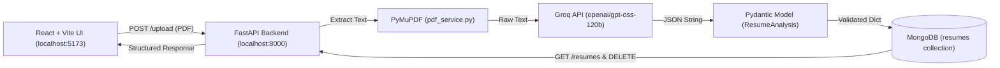
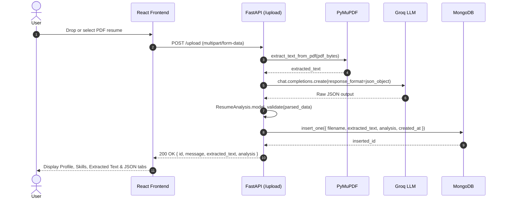

<div align="center">

# 🚀 AI Career Assistant

**Full-Stack AI Resume Analyzer & Candidate Profile Manager**

Upload any PDF resume and automatically extract text with **PyMuPDF**, structure candidate data via **Groq LLM**, enforce strict types with **Pydantic**, persist results in **MongoDB**, and explore everything in a modern **React + Vite** dashboard.

<p>
  
</p>

<p>
  
  
  
  
  
  
  
</p>

<p>
  <a href="#-agenda">Agenda</a> •
  <a href="#%EF%B8%8F-architecture">Architecture</a> •
  <a href="#-request-flow">Request Flow</a> •
  <a href="#-tech-stack">Tech Stack</a> •
  <a href="#-api-reference">API Reference</a> •
  <a href="#-quick-commands">Quick Commands</a> •
  <a href="#-project-structure">Project Structure</a>
</p>

</div>

---

## 📋 Agenda

| # | Stage | Component | What Happens |
| :-: | --- | --- | --- |
| **1** | **PDF Upload** | React + FastAPI (`POST /upload`) | User drags & drops a `.pdf` resume; frontend and backend validate file type and size |
| **2** | **Text Extraction** | PyMuPDF (`pdf_service.py`) | Extracts clean text across all pages of the uploaded PDF bytes |
| **3** | **AI Structuring** | Groq SDK (`llm_service.py`) | Sends extracted text to `openai/gpt-oss-120b` with JSON object mode enabled |
| **4** | **Schema Validation** | Pydantic (`ResumeAnalysis`) | Validates `candidate_name`, `email`, `phone`, `skills`, `experience_years`, `education`, and `professional_summary` |
| **5** | **Persistence** | MongoDB (`database.py`) | Stores filename, extracted text, validated analysis, and UTC timestamp in the `resumes` collection |
| **6** | **Dashboard UI** | React + Vite (`frontend/`) | Browse saved history, search candidates/skills, inspect raw text or JSON, export `.json`, or delete records |

---

## 🏗️ Architecture

### High-Level System Flow



### Component Breakdown

```text
+-----------------------------------------------------------------------------------+
|                            FRONTEND  (React 18 + Vite)                            |
|   UploadCard (Drag & Drop PDF)  |  SidebarHistory (Search)  |  AnalysisView       |
+-----------------------------------------+-----------------------------------------+
                                          |  HTTP / CORS  (http://127.0.0.1:8000)
                                          v
+-----------------------------------------------------------------------------------+
|                          BACKEND  (FastAPI + Uvicorn)                             |
|                                                                                   |
|   POST /upload  --->  PyMuPDF (Extract)  --->  Groq LLM (JSON)  --->  Pydantic    |
|   GET /resumes  <---  Motor Async Driver <----------------------------+           |
|   DELETE /resumes/{id}                                                            |
+-----------------------------------------+-----------------------------------------+
                                          |
                                          v
+-----------------------------------------------------------------------------------+
|                        DATABASE  (MongoDB :27017)                                 |
|   Database: ai_career_assistant   |   Collection: resumes                         |
+-----------------------------------------------------------------------------------+
```

---

## 🔄 Request Flow



---

## 🧰 Tech Stack

| Category | Tools & Libraries |
| --- | --- |
| **Frontend** | React 18, Vite 6, Lucide Icons, Custom Responsive CSS |
| **Backend API** | Python 3.10+, FastAPI, Uvicorn, `python-multipart` |
| **PDF Parsing** | PyMuPDF (`pymupdf`) |
| **LLM & Validation** | Groq Python SDK (`openai/gpt-oss-120b`), Pydantic v2 |
| **Database** | MongoDB, Motor (`AsyncIOMotorClient`), PyMongo |
| **Environment** | `python-dotenv` |

---

## 📡 API Reference

| Method | Endpoint | Purpose |
| --- | --- | --- |
| `GET` | `/` | API health check (`{"message": "AI Career Assistant API is running"}`) |
| `POST` | `/upload` | Uploads a PDF, extracts text, runs Groq + Pydantic validation, saves to MongoDB |
| `GET` | `/resumes` | Returns all saved resume analyses sorted by newest first |
| `DELETE` | `/resumes/{resume_id}` | Deletes a saved resume analysis by MongoDB `ObjectId` |

<details>
<summary><strong>Click to view sample <code>POST /upload</code> JSON response</strong></summary>

```json
{
  "id": "6733a1b2c3d4e5f60718293a",
  "message": "Resume uploaded and analyzed successfully",
  "extracted_text": "MANGALA RAVINDRA SAI...",
  "analysis": {
    "candidate_name": "MANGALA RAVINDRA SAI",
    "email": "ravindrasai44211@gmail.com",
    "phone": "+91-7989757788",
    "skills": ["React.js", "Node.js", "Python", "FastAPI", "MongoDB"],
    "experience_years": 1.3,
    "education": [
      "B.Tech, Computer Science and Engineering — Madanapalle Institute of Technology and Science (2021 – 2024)"
    ],
    "professional_summary": "Full-Stack Developer with production experience across React, Node.js, Express.js, MongoDB, and MySQL..."
  }
}
```

</details>

---

## ⚡ Quick Commands

### 1. Start MongoDB
```bash
mongod --dbpath /c/data/db
```

### 2. Configure & Run Backend
```bash
cd backend
python -m venv venv
source venv/Scripts/activate      # Windows Git Bash
pip install -r requirements.txt
```

Create `backend/.env` using [backend/.env.example](backend/.env.example):
```env
MONGODB_URI=mongodb://localhost:27017
MONGODB_DB=ai_career_assistant
GROQ_API_KEY=gsk_your_actual_groq_api_key
```

Start FastAPI:
```bash
uvicorn main:app --reload
```
- Swagger API Docs: **`http://127.0.0.1:8000/docs`**

### 3. Run Frontend
```bash
cd frontend
npm install
npm run dev
```
- Web Dashboard: **`http://127.0.0.1:5173`**

---

## 📁 Project Structure

```text
ai-career-assistant/
├── .gitignore
├── README.md
├── backend/
│   ├── .env.example                 # Environment variable template
│   ├── database.py                  # Async MongoDB client & lifespan hooks
│   ├── main.py                      # FastAPI entrypoint & CORS config
│   ├── requirements.txt             # Python dependencies
│   ├── routes/
│   │   └── resume.py                # Upload, list & delete endpoints
│   ├── schemas/
│   │   └── resume_analysis.py       # Pydantic ResumeAnalysis schema
│   └── services/
│       ├── llm_service.py           # Groq LLM client & JSON validation
│       └── pdf_service.py           # PyMuPDF text extraction
└── frontend/
    ├── index.html
    ├── package.json
    ├── vite.config.js
    └── src/
        ├── App.jsx                  # Main layout, health check & state
        ├── api.js                   # Backend API client
        ├── main.jsx
        ├── styles.css
        └── components/
            ├── AnalysisView.jsx     # Profile, Extracted Text & Raw JSON tabs
            ├── SidebarHistory.jsx   # Searchable MongoDB history sidebar
            └── UploadCard.jsx       # Drag-and-drop PDF uploader
```

---

## 🗺️ Roadmap

- [ ] Job description matching & ATS compatibility score
- [ ] Skill-gap analysis & tailored resume improvement suggestions
- [ ] Candidate comparison view & exportable PDF reports
